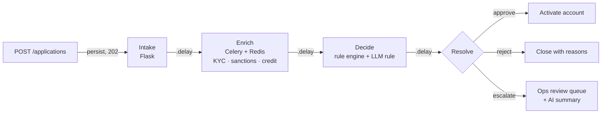

# Fintech Onboarding & Risk Decisioning

**A reference design for business onboarding at a fintech: fast intake, asynchronous KYC/credit/fraud enrichment, a rules-plus-LLM decision step, and an ops review queue with AI-written summaries — instrumented around the activation funnel.**

Every application a fintech can safely decide without a human is a customer activated sooner. Every one it decides wrongly is a loss or a compliance problem. This project sketches the pipeline that balances the two, in Python with Flask, Celery, and OpenTelemetry.

## Pipeline

## Design decisions

- **The applicant never waits on a provider.** Intake validates the minimum (`legal_name`, `ein`), persists the application, queues enrichment, and returns `202`. Persist-then-process means a crash mid-enrichment is retryable.
- **Flaky providers retry, they don't fail applications.** Enrichment is a Celery task with `max_retries=3` and a 10-second delay on provider errors.
- **The LLM is one voice, not the decider.** `review_ai.llm_review` forces strict JSON (`risk`, `rationale`, `flags`), validates it, and defaults to `medium` on anything unexpected. `decision.py` adds it to the rule engine as a weighted rule — 0 / 20 / 40 points for low / medium / high — so the final call stays with the rules and every reason is recorded.
- **Escalations arrive with context.** Escalated applications are queued for ops along with an AI summary of the concern, so reviewers start from "here's what's wrong" rather than raw data.
- **Measure the funnel, not vanity counts.** OpenTelemetry spans wrap each stage; metrics track decisions by outcome, time in the review queue, and fraud flags. `funnel.py` reports the auto-decision rate, escalation rate, median review time, and conversion — the levers for widening or tightening auto-approval.

See [ARCHITECTURE.md](ARCHITECTURE.md) for the stage-by-stage description.

## Layout

| File | Stage |
|---|---|
| `src/intake.py` | Flask blueprint: `POST /applications` |
| `src/enrich.py` | Celery app and enrichment task |
| `src/decision.py` | Rule engine wiring plus the LLM rule |
| `src/review_ai.py` | Structured LLM review prompt and validation |
| `src/resolve.py` | Activate, reject, or enqueue for review |
| `src/metrics.py` | OpenTelemetry tracer, meter, and stage decorator |
| `src/funnel.py` | Activation-funnel report |
| `src/pipeline.py` | Named stage list |
| `tests/test_pipeline.py` | Intended end-to-end tests: clean business auto-activates; risky one is escalated with a summary |

## Tech stack

Python · Flask · Celery · Redis · OpenTelemetry · an LLM chat API. PostgreSQL and SQLAlchemy are the intended persistence layer.
